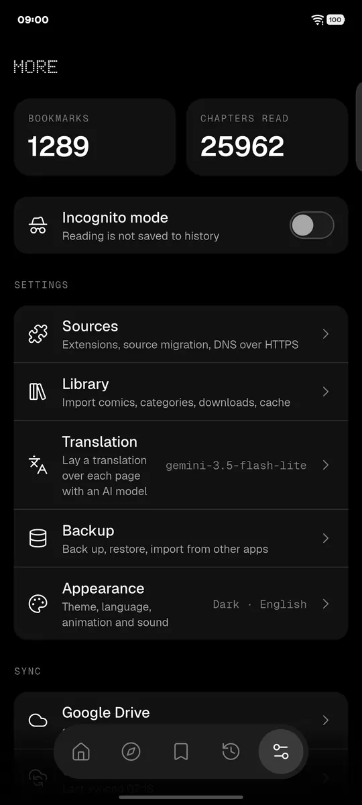
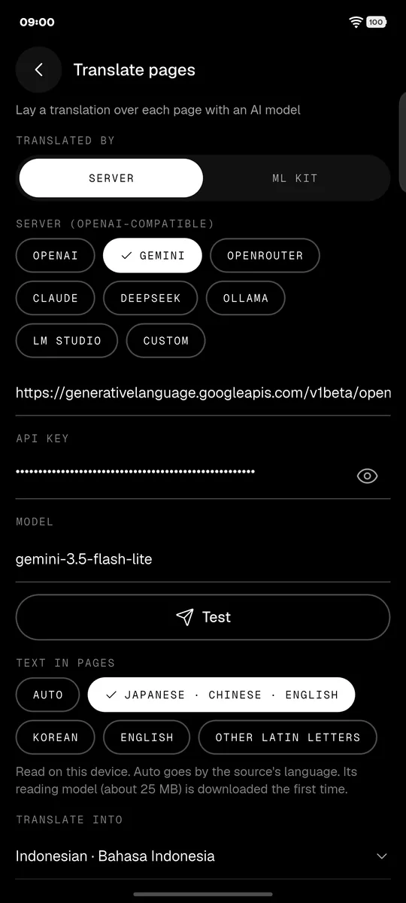

<div align="center">
  
  <h1>Yoru</h1>
  <p>
    <a href="https://github.com/sofyan-rs/yoru-comic-app/releases/latest"></a>&nbsp;&nbsp;
    <a href="LICENSE"></a>
  </p>
  <p>
    <a href="https://ko-fi.com/Q7Q02B3OYT"></a>
  </p>
</div>

A reader for manga, manhwa and manhua from several sources. Each source is a small JavaScript extension the app installs from an extension repo, so new sites can be added without an app update. Browse and search comics, read chapters online or download them to read offline, and keep a personal library of bookmarks, categories and reading history. The library lives on the device; you can export it to a backup file or, optionally, sync it across devices through your own Google Drive.

## Download

Get it from the [Releases](https://github.com/sofyan-rs/yoru-comic-app/releases) page:

- **Android:** the APK; `arm64-v8a` fits almost every phone. Android 7.0 or newer.
- **iOS:** the `.ipa` (iOS 16 or newer), unsigned: sideload it with AltStore, SideStore or Sideloadly. For updates, add the source `https://yoru.kurodev.org/altstore.json` in AltStore or SideStore. See [iOS limits](#ios-limits).
- **Windows:** `windows-setup.exe` (Windows 10 and 11, 64-bit).
- **macOS:** the `.dmg` (macOS 14 or newer). Not signed yet: open it the first time with right click → Open.
- **Linux:** the `.AppImage` (64-bit), or `.rpm` for Fedora (`sudo dnf install ./Yoru-<version>-linux-x86_64.rpm`). The in-app WebView needs WebKitGTK 4.1, which most desktops already have (`libwebkit2gtk-4.1-0` on Debian and Ubuntu, `webkit2gtk4.1` on Fedora); without it "Open in WebView" opens the browser and sources that need a WebView do not load.

The app checks for new releases and updates itself (on Linux when run from the AppImage; on iOS it hands the IPA to AltStore or SideStore). More on the [website](https://yoru.kurodev.org).

Fedora RPM installs can update from inside the app: approve the system's administrator prompt, then the app restarts after installation. You can also download and install the new RPM with the same `sudo dnf install` command.

## Screenshots

| Splash                                                             | Home                                                                                                  | Sources                                                                                        | Explore                                                                                            |
| ------------------------------------------------------------------ | ----------------------------------------------------------------------------------------------------- | ---------------------------------------------------------------------------------------------- | -------------------------------------------------------------------------------------------------- |
|  |  |  |  |

| Filter                                                                                             | Detail                                                                                             | Reader                                                                                      | Bookmarks                                                                                                            |
| -------------------------------------------------------------------------------------------------- | -------------------------------------------------------------------------------------------------- | ------------------------------------------------------------------------------------------- | -------------------------------------------------------------------------------------------------------------------- |
|  |  |  |  |

| History                                                                                               | Extensions                                                                    | More                                                                                                                               |
| ----------------------------------------------------------------------------------------------------- | ----------------------------------------------------------------------------- | ---------------------------------------------------------------------------------------------------------------------------------- |
|  |  |  |

| Download chapters                                                                                                | Downloads                                                                                             | Light theme                                                                      |
| ---------------------------------------------------------------------------------------------------------------- | ----------------------------------------------------------------------------------------------------- | -------------------------------------------------------------------------------- |
|  |  |  |

| Page translation                                                                                                                  | Translation settings                                                                                                                                                 |
| --------------------------------------------------------------------------------------------------------------------------------- | -------------------------------------------------------------------------------------------------------------------------------------------------------------------- |
|  |  |

Screenshots were taken on a real device (iQOO I2218, Android 16).

### Desktop

| Home                                                                                                  | Explore                                                                                                          |
| ----------------------------------------------------------------------------------------------------- | ---------------------------------------------------------------------------------------------------------------- |
|  |  |

| Detail                                                                                                     | Reader                                                                                                     |
| ---------------------------------------------------------------------------------------------------------- | ---------------------------------------------------------------------------------------------------------- |
|  |  |

Desktop screenshots were taken on Windows 11 running v2.21.0.

## Features

- **Sources:** pick the source in the header of Home or Explore. The app ships without sources: install them from More → Sources → Extensions. A multi-language source becomes one source per enabled language (for example EN and ID), each with its own bookmarks and history. Installed extensions show an update badge when the repo has a newer version. On Android 9+, Mihon / Tachiyomi extensions install too (see [Extensions](#extensions)).
- **Extensions:** icons, an 18+ label (18+ extensions are hidden until you show them), search by name or site, and a language picker, for installed and available extensions alike.
- **Home:** continue reading with chapter progress, new series (or popular, when the source has no newest order) and the latest updates of the current source. Pull to refresh for a small easter egg.
- **Explore:** title search combined with the source's own filters (type, status, sort, genres…), with infinite scroll. Long filter lists fold away behind "Show all".
- **Comic details:** alternative titles (other languages and romanized names; tap to see them all), source and language, rating, chapter count, release year, synopsis and genres. The chapter list can be searched and sorted, marks new, read, partly read (`5 / 24`) and downloaded chapters, and supports selecting chapters to download them or mark them read or unread. Share a comic as a link that opens the app, save its cover, or long-press the title to copy it. Without a connection, comics you downloaded, bookmarked or read still open from the details saved on the phone.
- **Reader:** vertical strip or page by page (right-to-left or left-to-right), fit to width or height, keep the screen on, optional gap between pages. Double-tap or pinch to zoom, and move the zoomed page in any direction; page meter, previous/next chapter, and a "chapter finished" card. Reopens a chapter at the page you stopped at. Auto-scroll with adjustable speed in the vertical reader. Downloaded chapters open from the phone. Long press a page to save it to the gallery.
- **Page translation (optional, off by default):** in the reader's ⋮ menu, turn on Translate pages for a comic; translated text is laid over each speech balloon, and a small button on each page shows the original again. The text is read on the device (PaddleOCR; its model, about 25 MB, downloads the first time) and only the text, never the page, is translated by what you pick in More → Translation:
  - **Server:** any OpenAI-compatible API (OpenAI, Gemini, OpenRouter, Claude, DeepSeek) or a local one (Ollama, LM Studio), with your own key. A local server on another computer must be reachable from the phone: same network, and the server listening on the network (for Ollama, `OLLAMA_HOST=0.0.0.0`), e.g. `http://192.168.1.10:11434/v1`.
  - **ML Kit** (Android and iOS): Google's offline translation; language packs (about 30 MB each) download the first time. Fast and free, plainer than an AI model.

  Nothing downloads until you use it, translations are cached so a page is translated once, and only the page on screen and the next three are translated, once you stop on a page (the next three in one request, to save tokens). Reader ⋮ → Translate chapter again, or holding a page's small button, tries a page again with the same model. Settings also cover the target language, the kind of text in pages (picked from the source's language by default: Japanese/Chinese, Korean, English or other Latin letters), your own notes for the translator, all caps and the lettering font (Patrick Hand, Komika Hand, Comic Neue, or a `.ttf`/`.otf` you import).

- **Bookmarks:** language badge and unread-chapter badge on each card, read progress and search by title or alternative title across every tab (tab counts show the matches). Swipe the comics sideways to change tab. Group them by status, source or your own categories (a comic can be in several); pick a category when you bookmark, or skip. Pull to refresh checks the comics on screen (the open group, narrowed by a search) for new chapters, with a progress notification; stop it from the notification's Cancel button or the stop button in the header. A comic that takes too long is skipped.
- **History:** last read chapter per comic, grouped by day; swipe to delete.
- **Downloads:** download chapters for offline reading. Downloads keep going in the background and while the phone is locked, with a progress notification. More → Library → Downloads shows the storage used, the queue with retry and cancel, and downloads grouped per comic. Files stay in the app's own storage and are removed when the app is uninstalled.
- **Local comics:** import CBZ or ZIP files, and on Android and desktop folders of images, from More → Library → Import comics or the empty Home of the Local source. They are copied into the app, bookmarked and read offline. Name files like `Series - Ch. 12.cbz` (or `Vol. 3`), or put a `ComicInfo.xml` in the CBZ, so the chapters of a series group together. A local comic's menu has Add chapters (files go into that comic, whatever their names), Edit details (title, author, synopsis, genres, cover) and Delete from device. Local comics stay on the device: Google Drive sync leaves them out.
- **Migration:** in More → Sources → Migrate source, move bookmarks and reading history to another source, one comic, a selection or a whole source: each title is searched in the new source (and, if nothing comes up, its alternative titles), matches by title or alternative title are picked for you and you choose the rest. In More → Backup → Import from other apps, import your library from a Mihon / Tachiyomi backup (`.tachibk`: bookmarks from sources Yoru has, with their categories and read chapters) or from a site's CSV export of your list (titles are searched in that site's source, one at a time). Imported comics load their covers and chapters when you open them or refresh, and the chapters you had read are marked read then. A series you already bookmarked from another source is not added twice.
- **Sync:** turn on Google Drive sync in More to sync bookmarks, categories and reading history across devices. The library is kept as one file in the app's hidden Drive folder (`drive.appdata`), so the app cannot see your other Drive files. Nothing goes through our servers.
- **Data:** back up and restore the library to a file, clear cached chapter pages (covers and downloads are kept), and choose the system, light or dark theme.

## Extensions

The app reads extensions from this repo by default:

```
https://yoru-ext.kurodev.org/index.json
```

A second repo is built from the public extension source (its extensions differ from the default repo's):

```
https://sofyan-rs.github.io/yoru-ext-public-source/index.json
```

Add a repo in More → Sources → Extensions → Extension repos. Extensions run code and access the internet, so only add repos you trust.

**Mihon extensions (Android 9+ and desktop, not iOS).** A Mihon / Tachiyomi extension repo works too: paste its `index.min.json`, `repo.json` or base URL. Its extensions install inside the app (no separate APK install) and work like the app's own: browse, search, filters, the reader, downloads (in the background too), a scanlator picker when a comic has several, and their own settings. They update from the same repo, and an APK is only loaded when it is signed with the key the repo publishes. Bookmarks from a Mihon backup map straight to these sources.

**Want to make your own extension?** Start from [sofyan-rs/yoru-ext-public-source](https://github.com/sofyan-rs/yoru-ext-public-source): it has example extensions, the extension contract, and guides to write, test and publish one. Host the built `index.json` anywhere and add its URL as a repo in the app.

Some extensions are reimplemented from the Tachiyomi / Mihon extensions in [keiyoushi/extensions-source](https://github.com/keiyoushi/extensions-source) (Apache License 2.0); each one credits its source in its file.

## Requirements

- Android 7.0+ (API 24); Mihon extensions need Android 9+ (API 28)
- iOS 16+ (sideloaded); DNS over HTTPS for WebViews and extensions needs iOS 17+
- Windows 10+ (x64), macOS 14+, Linux x64; Mihon extensions run there too
- Page translation: ML Kit on Android and iOS; server translation and OCR on every platform

To build from source, see [Contributing](docs/CONTRIBUTION.md).

### iOS limits

The iOS app is the same app, with what iOS allows:

- **Sideload only.** The IPA is unsigned and not on the App Store. AltStore, SideStore and Sideloadly sign it with your Apple ID; with a free Apple ID the app must be refreshed every 7 days.
- **No Mihon extensions.** They are Android code (APKs), which iOS cannot run. Only Yoru extensions (`…/index.json` repos) work.
- **Updates go through the sideloading app.** The app tells you about a new version and opens it in AltStore or SideStore (or the IPA in Safari); it cannot install itself.
- **Work stops in the background.** iOS suspends the app a few seconds after you leave it, so a bookmark refresh or download pauses until you come back. Refresh progress is a plain `done / total` notification, without a progress bar.
- **DNS over HTTPS** covers WebViews and extensions only on iOS 17 or newer; on iOS 16 they use the system DNS.
- **Less tested** than Android: background downloads and extensions that render pages in a hidden WebView.

## Docs

- [Architecture](docs/ARCHITECTURE.md): structure, layers, sources and extensions, storage, Dotline UI rules
- [Contributing](docs/CONTRIBUTION.md): setup, build, conventions, testing, PR checklist
- [Link hosting](hosting/README.md): Cloudflare Worker for shared links, the website and the privacy policy

## Credits

- [Mihon](https://github.com/mihonapp/mihon) (Apache License 2.0), the successor of Tachiyomi: Yoru uses it as a reference for features and behavior, such as extensions and extension repos, the library and categories, the reader, migration and the `.tachibk` backup format read by the Mihon import.
- [keiyoushi/extensions-source](https://github.com/keiyoushi/extensions-source) (Apache License 2.0): reference for some extensions (see [Extensions](#extensions)).
- [SCANCORE](https://github.com/medium-gh/scancore) (MIT): its extension host and its copy of Mihon's source API are the base of the Mihon extension support in `android/mihon`; Mihon's chapter-number recognition comes from Mihon.

## Disclaimer

Yoru is not affiliated with any of the sites it reads from, and it does not host, store or distribute any comics. Like a web browser, it only shows content that is already freely available on those sites. Copyright and DMCA takedown requests should go to the owners of the site that hosts the content.

## License

Yoru is free software under the [GNU General Public License v3.0](LICENSE): you can use, study, change and share it, and apps built from it must stay open source under the same license.

`android/mihon` contains Mihon's source API and chapter recognition (Apache License 2.0) and code from SCANCORE (MIT, `android/mihon/LICENSE-SCANCORE`), each file keeping its notice.

Extensions are a separate project under the Apache License 2.0 ([public source](https://github.com/sofyan-rs/yoru-ext-public-source)). Third-party assets keep their own licenses: the Geist, Geist Mono and Doto fonts (SIL Open Font License 1.1), Lucide icons (ISC). Comics shown in the app and the screenshots belong to their publishers.

Found a bug or have an idea? [Open an issue](https://github.com/sofyan-rs/yoru-comic-app/issues/new).
